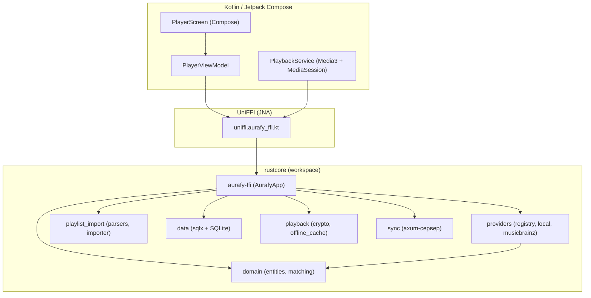

# Архитектура AuraFy

## Обзор

Rust-ядро (domain + data + playback + import + providers + sync) связывается с Kotlin/Jetpack Compose UI через UniFFI (proc-macro, библиотечный режим). Аудио-вывод — Media3/ExoPlayer на стороне Android; Rust отвечает за бизнес-логику, каталог, кэш, БД и (перспектива) декодеры через FFI.

## Слои

| Слой | Крейт | Ответственность |
|------|-------|-----------------|
| Domain | `domain` | `Track`, `Playlist`, `MusicProvider` trait, fuzzy-matching (strsim + Unicode NFKD-нормализация) |
| Data | `data` | SQLite через sqlx, миграции, репозиторий |
| Providers | `providers` | `ProviderRegistry`, `LocalLibraryProvider` (файлы пользователя), `MusicBrainzProvider` (открытые метаданные) |
| Import | `playlist_import` | `PlaylistSource` trait, парсеры M3U/XSPF/CSV/JSON, сопоставление, отчёты |
| Playback | `playback` | AES-GCM шифрование оффлайн-кэша |
| Sync | `sync` | REST-сервер на axum для синхронизации между устройствами |
| FFI | `aurafy-ffi` | `AurafyApp` — facade для Kotlin: `search`, `searchMetadata`, `resolveStreamUrl`, `addLocalLibrary` |

## Ключевые решения

- **UI: Kotlin + Compose (не Flutter).** Media3/ExoPlayer, MediaSession (lock-screen, Bluetooth, Android Auto) — first-class Android API; FFI через JNA проще, чем через dart:ffi + плагины; Rust-ядро остаётся переиспользуемым (iOS через Swift-биндинги UniFFI).
- **UniFFI proc-macro + library mode.** Биндинги генерируются из собранной cdylib (`ffi/src/bin/uniffi-bindgen.rs`), UDL не нужен.
- **Блокирующий мост в FFI.** `AurafyApp` бриджит tokio-runtime; на Kotlin вызовы оборачиваются в `Dispatchers.IO`.
- **Провайдеры сменные.** Пользователь подключает свои легальные источники (локальные файлы, свой сервер, API с подпиской). Встроены только `local` и `musicbrainz` (метаданные, без аудио).

## Схема БД (SQLite, `migrations/0001_init.sql`)

- `tracks` — каталог треков (artists/external_ids как JSON)
- `playlists`, `playlist_tracks` (position)
- `likes`, `listen_history`
- `offline_cache` (зашифрованные файлы)
- `import_reports`, `sync_state`

## Юридическая рамка

AuraFy **не распространяет защищённый контент**. Все аудио-источники подключает пользователь и несёт ответственность за их легальность. Встроенный провайдер — только локальные файлы пользователя и открытые метаданные MusicBrainz (CC0).
